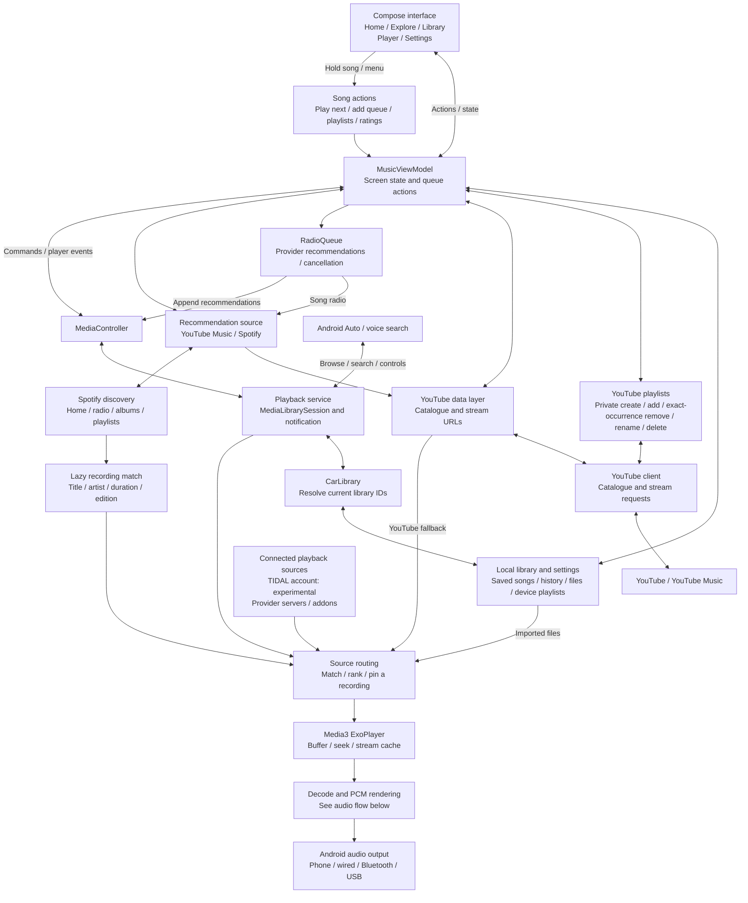
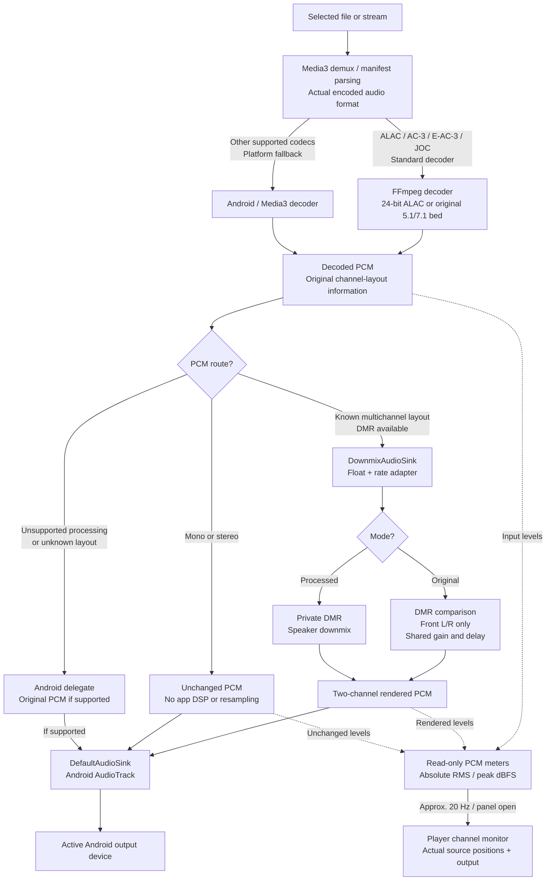
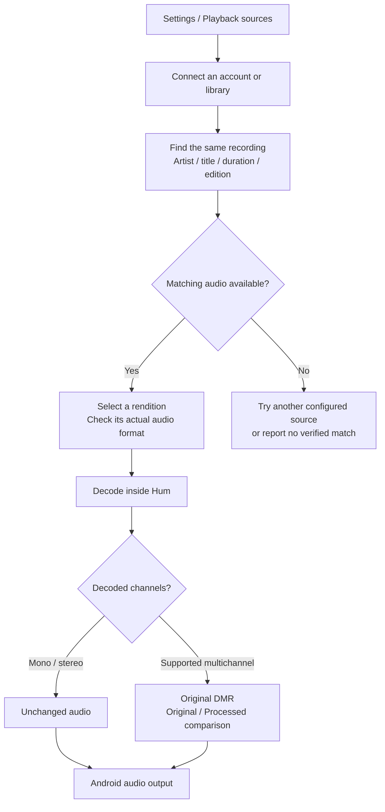
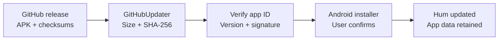

# Hum — a music player for Android

Hum (package `labs.rtensor.music`) is a native Android player from RTensorLabs, built around a simple goal:

> **Find what you enjoy, then play the best available matching recording in one app.**

Hum has one look: Berry accents, the Character typeface, a pinned player, a floating
navigation pill and top-tab Settings. Android 9+ is the supported baseline.

### New in 0.4.0 beta 6

- **Import playlists from a folder.** Import playlist → *Choose a folder of playlists*
  turns every M3U/M3U8, PLS, XSPF, CSV or JSON file in it (subfolders included) into a
  playlist and reads the local songs from the same folder. A folder of songs with no
  playlist files becomes one playlist per folder.
- **What’s new before you update.** Settings → About shows the release notes of an
  available update before you download or install it.
- **Import progress** for songs from your device now appears under *Import audio*;
  *Export downloads* shows only export progress.

### Earlier in 0.4.0

- **Lyrics follow the song** in a window that fills the space under the player on any
  phone size and keeps the current line on screen (beta 4–5). **Original / English** chips
  sit with the lyrics and apply to every song. “English” means the same words in English
  letters (ನಾನು → *nanu*, मैं → *main*), not a translation.
- **Export downloads** to a folder of your choice, and **import music** from the device:
  one file, many files, a folder, or several folders in turn (Settings → Sources).
- **Spotify** shows your liked songs and playlists as well as albums.
- **Listen again**: songs played in Hum are reported to your YouTube Music history
  (turn it off with Settings → Privacy → Keep listening history).
- **Browse** is gone; Explore is For you and Discover. Releases are named `Hum.apk`.
- Open-source licences are removed from Settings → About for now and return with the
  expanded list.

See [CHANGELOG.md](CHANGELOG.md) for every release.

## Our goals

1. **Help you discover music.** Let you choose YouTube Music or Spotify for
   recommendations, albums, playlists and the songs that come next.
2. **Choose a suitable audio source.** Find the same recording among your files
   and connected playback sources, checking the artist, title, duration and edition.
3. **Aim for the best available quality.** Prefer a matching surround recording
   when available, then suitable lossless audio. Actual availability depends on
   the recording, provider, account, device and working integration.
4. **Use the original Downmix Renderer inside the app.** Keep stereo unchanged
   and process supported multichannel input through DMR, with Original/Processed
   comparison. DMR’s rendered output is stereo; multichannel describes its input.
5. **Keep everyday listening simple and fast.** Prioritise reliable Play/Pause,
   seeking, skipping, queue behaviour, imports and responsive scrolling.

Recommendation choice and audio source are independent. A Spotify recommendation
can play from a matching local file, connected provider or YouTube. Its catalogue
entry alone does not establish lossless or Dolby Atmos playback.

## How our goals compare with other apps

These are simple descriptions of each app’s focus. Many goals overlap; the table
does not claim that a feature belongs exclusively to one app or that Hum has
already completed all of its goals. Some code, package names (`labs.rtensor.music`)
and the sections below still say “Music”; it is the same app.

| App | Main goal in simple words |
| --- | --- |
| [Crates](https://crates.app/features/) | Bring your music collections together and organise them with tags, ratings, smart collections and device sync. |
| [Spotify](https://www.spotify.com/) | Help you discover and listen to its catalogue through personalised recommendations and playlists. |
| [YouTube Music](https://music.youtube.com/) | Help you discover and listen to music from YouTube’s catalogue, including official songs, live performances and covers. |
| [Apple Music](https://www.apple.com/apple-music/) | Offer a subscription music catalogue, including lossless and Dolby Atmos listening in supported setups. |
| [Spotube](https://github.com/team-spotube/spotube) | Let users combine music metadata, playlists and audio sources through plugins on desktop and mobile. |
| [Tryptify](https://github.com/tryptz/Tryptify) | Offer Android hi-fi listening with multiple sources, detailed DSP/EQ controls and visual feedback. |
| **Hum — this app** | **Combine a choice of discovery services with the best available matching audio and the original DMR, inside a simple Android listening app.** |

For Hum, the practical priorities are correct recording matches, clear audio
quality information, reliable surround processing and smooth everyday playback.
A combined library is part of that experience. The current UI can stay while
those features improve.

## Playlist imports

[Playlist imports and Spotify sign-in handoff](PLAYLIST_IMPORTS.md) describes the
supported import formats, history-sync limits and remaining local validation. Import
from a file or, since beta 6, from a whole folder of playlists (see above).

## Quick guide

1. **Install or update.** Get the [current preview release](https://github.com/RTensorLabs/music-app/releases) (download `Hum.apk`).
   Existing installations can use **Settings → About → Check updates**.
2. **Choose recommendations.** Open **Settings → Playback → Recommendation source**.
   YouTube Music is the default. Selecting Spotify starts its sign-in; the choice
   is saved after verification. See the [Spotify guide](SPOTIFY_RECOMMENDATIONS.md).
3. **Search and explore.** Home contains the full provider recommendation feed
   and YouTube mood filters. Keep scrolling to load the next available page.
   **Explore → For you** holds last played, recent listening and personal highlights.
   **Discover** shows provider discovery shelves and can use genuine already-loaded
   Home shelves when the separate Explore request is empty or fails. No categories
   or music are invented to fill a tab.
   Each page keeps its position when opening and leaving the player.
   Search uses YouTube and offers suggestions as you type.
4. **Add your files or playback sources.** Use **Settings → Sources → Import audio**
   for files, a folder or several folders, and **Export downloads** to copy your
   downloaded songs to a folder. **Library → Playlists → Import playlist** reads a
   playlist file or a whole folder of them. **Playback sources** contains provider and personal-server
   connections. Supported files can be stereo, lossless or multichannel.
5. **Compare multichannel playback.** For supported input, the player offers
   **Original** and **Processed**. Stereo plays unchanged. The channel monitor
   appears only after enabling **Settings → About → Developer options**.
6. **Keep control of your queue.** Hold a song or tap its **⋮** menu for Play next,
   Add to queue, Start radio, sharing and playlist actions. Explicit additions go
   ahead of generated radio without restarting the playing song. Individual songs can start provider radio;
   albums, playlists and Play all preserve their explicit order. Changing the
   recommendation source preserves the current song, position and manual queue,
   replacing only future automatically generated tracks.
7. **Make playlists.** Open **Library → Playlists**, create one from a song's menu,
   or use **Save queue as playlist** in Up next. New online-song playlists default
   to private YouTube Music sync and require the connected YouTube account. You
   can choose a device-only playlist instead. Add, rename, remove a song or delete
   a playlist; account changes are reported only after YouTube confirms them.
   Local audio stays in device playlists and is never uploaded. Playlist details
   load in pages: **Load more songs** extends them; Play loaded songs plays the
   loaded portion, up to the queue's 100-song limit.

**Saved in Hum and YouTube likes are separate.** The heart saves a recording
inside Music. For account likes, use **Like on YouTube Music**, **Dislike on
YouTube Music** or **Remove YouTube rating** in the song menu. Device playlists
are not automatically uploaded when you connect an account.

## What is ready and what is still a goal?

| Area | Current position |
| --- | --- |
| Android player, Saved, history and local imports | Implemented, with automated regression coverage. |
| Song menus, search suggestions and playlists | Implemented with fixture and Android host tests. YouTube playlist writes and ratings still need a signed-in device check. |
| YouTube Music recommendations | Implemented, with provider radio rather than history copied into Up next. |
| Spotify recommendations and collections | Experimental metadata integration. Public catalogue requests and browser tests pass; signed-in personalisation and phone performance still need verification. |
| Local multichannel audio and DMR | Integrated. Host tests cover the real decoder/renderer path, stereo bypass and comparison switching. |
| Apple Music and TIDAL account playback | Experimental. Live account access and delivered audio quality still need device validation. |
| Qobuz and personal music libraries | Available through configured playback-source connections. |
| Android Auto | Home, Saved and Recent (hidden while history is off), search and playback controls in the car, with automated regression coverage. Not yet checked on a car or the Desktop Head Unit. Songs chosen in the car are added to history and continue with radio only while Music is open on the phone. |
| Consistent lossless/multichannel playback across providers | A goal being validated, dependent on available matching recordings and working provider access. |

The player separates the **audio provider** from its format: Apple Music AAC,
ALAC/FLAC lossless, supported surround audio, or a YouTube fallback. A Spotify
recommendation can therefore play from Apple Music without changing its discovery
identity. The provider name updates if playback falls back.

The player describes the format actually received. Stereo lossless remains
stereo. Supported E-AC-3/JOC decoding currently supplies its standard 5.1/7.1
surround bed to DMR; this does not recover the full Atmos object scene. Discovery
metadata, a successful sign-in or an album badge does not prove the audio format.
See [verification and current limits](VERIFICATION.md).

Home holds the full provider feed. Explore separates personal listening from
discovery shelves. Android Auto shares the
phone's playback engine, library and provider routing. See
[verification and current limits](VERIFICATION.md).

[Shareable layout review](https://music-layout-review.chalkybongo1.chatgpt.site):
smaller Home covers and three player options. This is a design prototype; it
does not play audio or change the Android app’s current player layout.

## Architecture

Hum has three main paths: **discover a recording**, **choose its audio source**,
and **decode/render it inside the Android app**. The diagrams describe the current
implementation; experimental adapters and unfinished integrations are labelled.

### App and playback control



The user chooses **YouTube Music or Spotify** under Settings → Playback →
Recommendation source. Spotify supplies discovery metadata and playlist entries;
audio continues through Music’s existing playback sources. Its account connection
and personalised results still need device validation.

The ViewModel uses local listening history only to choose seeds for Mixed for you.
YouTube candidates retain the existing on-device ranking; Spotify pools retain
provider order. Up next comes from the selected provider through `RadioQueue`, preserving provider order
and excluding already-queued songs. Individual selections seed radio; explicit
albums/playlists and Play all keep their lists. History is not an autoplay pool. Play next and Add to queue keep manual choices
ahead of the generated tail. Moving to a manually chosen song reseeds radio;
late results for the previous seed cannot replace it.
The catalogue item keeps its YouTube or Spotify discovery identity, artwork
and history when another source supplies the audio. Matching checks title, artist, duration and edition.
Available candidates rank **JOC first → discrete lossless multichannel → lossless
stereo by sample rate/bit depth**, with local files competing against connected
sources. An explicitly imported local track plays its own file directly.

Source selection happens before the physical MediaSource is created. Seeks retain
that source and encoding. A failed or contradictory provider format triggers a
bounded fallback through a new source at the current position. Rendition rejection
is independent of rotating URLs; byte-cache reuse across changing paths requires
an explicit immutable-file identity. Adaptive streams keep their representation
pinned and bypass the progressive-file cache.

**ExoPlayer plays the audio.** Provider requests and source selection run off the UI/audio
threads. Software decoding uses a worker; PCM rendering runs in Media3's audio
path. Player events and `AudioPipeline` reports update the UI, while a separate
position StateFlow updates the timelines without rebuilding the whole screen.
The expandable channel monitor has its own level StateFlow; metering is disabled
when collapsed, paused or outside the foreground.

### Audio signal flow



The adapter converts known multichannel **44.1/88.2/176.4 kHz → 48/96/192 kHz**
for the core. Stereo bypasses that conversion. Hum uses unity preamp for the surround path, retaining the original core's peak
limiter instead of the previous fixed −14 dB cut. Stereo bytes remain unchanged.
Original and Processed share the
stream lifecycle and switch with a fade, without loading another recording.
The private adapter explicitly disables synthetic upmixing. The standard decoder
feeds its original 5.1/7.1 bed to DMR; no invented side, rear or height speakers,
HRIR convolution or app binaural stage is added.

The private DMR is bundled into integrated APKs through JNI; there is no separate
DSP app to install. Its implementation and coefficients stay outside this public
repository. **Multichannel here describes the decoded input:** processed output is two-channel PCM. Physical output routing remains Android's
responsibility. Android's mixer/hardware may convert
audio, so stereo bypass does not establish system-wide bit-perfect output.

Unsupported layouts use the Android delegate only when it accepts the format.
Other failures are classified by decoder, layout, DSP or output stage and reported
back to the player.

Hum uses FFmpeg's standard E-AC-3/JOC surround-bed decode. The experimental
scene decoder is not registered or packaged, and its setting is removed.
[PCM/DSP integration](dsp/README.md) and [provider status](PROVIDER_PLAYBACK_STATUS.md)
describe the current route. Decoder research remains in its standalone module.

See [recommendation setup and test boundaries](SPOTIFY_RECOMMENDATIONS.md).

### Accounts, storage and updates

Accounts connect in the app. Session credentials are encrypted using Android
KeyStore, while preferences, Saved and listening history remain on the device.
Account authorization is kept separate from requests to audio/CDN hosts.

Apple Music and TIDAL account playback remain experimental. Their availability,
account access and delivered quality require testing on supported devices. Qobuz
and personal-library playback use configured source connections. These options
do not establish that every recording is available in lossless or multichannel.

### Provider playback at a glance



Source matching and format checks protect against playing a different edition
or presenting a stereo stream as multichannel. Provider availability and real
account playback remain subject to the validation limits above.



Updates require the same package and signing certificate and a newer version
code. The Android installer asks the user to confirm installation.

### Code map

| Component | Responsibility |
| --- | --- |
| [MainActivity](app/src/main/java/labs/rtensor/music/MainActivity.kt), [UI](app/src/main/java/labs/rtensor/music/ui/) | Compose screens, system account/file pickers and playback controls. |
| [MusicViewModel](app/src/main/java/labs/rtensor/music/MusicViewModel.kt) | Observable state, catalogue requests, queue commands, history, radio and the independent progress clock. |
| [YouTubeRuntime](app/src/main/java/labs/rtensor/music/data/YouTubeRuntime.kt), [youtube-engine](youtube-engine/) | YouTube catalogue, account state and audio-stream resolution. |
| [Auth](app/src/main/java/labs/rtensor/music/auth/), [YouTubeLoginActivity](app/src/main/java/labs/rtensor/music/YouTubeLoginActivity.kt) | Google/YouTube account connection and sign-in screens. |
| [Playback](app/src/main/java/labs/rtensor/music/playback/) | MediaSession/ExoPlayer, source factories, cache/range handling, fallback, background playback and notification. |
| [Playback sources](app/src/main/java/labs/rtensor/music/sources/) | TIDAL account adapter, server/addon connectors, manifest validation, matching, ranking and rendition/file identities. |
| [Spotify catalogue](app/src/main/java/labs/rtensor/music/spotify/), [browser bridge](app/src/main/assets/spotify/catalogue.js) | Spotify discovery, recommendation feed/radio, paged albums/playlists and lazy recording matching. |
| [RadioQueue](app/src/main/java/labs/rtensor/music/playback/RadioQueue.kt) | Provider-supplied Up next, cancellation of stale requests, duplicate exclusion, and retry status. |
| [Local data](app/src/main/java/labs/rtensor/music/data/) | Library/history, imported master matching, account storage, metadata and on-device recommendation helpers. |
| [decoder-ffmpeg](decoder-ffmpeg/) | Software ALAC and standard AC-3/E-AC-3 surround-bed decoding before the PCM sink. |
| [decoder-openjoc](decoder-openjoc/) | Standalone experimental reconstruction research; excluded from Hum. |
| [dsp](dsp/) | PCM/rate/layout adapter, original private DMR JNI boundary, Original/Processed comparison and diagnostics. |
| [Updates](app/src/main/java/labs/rtensor/music/updates/) | GitHub release discovery and verified in-place APK updates. |

## Current release

[Hum 0.4.0 beta 6](https://github.com/RTensorLabs/music-app/releases/tag/v0.4.0-beta.6)
is the latest preview. Home carries the full recommendation feed with continuous
loading. Explore’s For you keeps personal listening highlights, and Discover keeps
actual provider content even when the separate Explore response is empty or fails.
Each page keeps its own scroll position. See [CHANGELOG.md](CHANGELOG.md) for what
changed in every beta.

Automated app checks cover the player, navigation, account recovery, car browsing
and queue selection. Existing DSP and browser results remain baseline evidence;
they are not new phone performance or subscriber-playback measurements. See
[verification](VERIFICATION.md) and the release assets for completed counts,
source commit, APK checksums and packaging evidence.

## Build

Use JDK 17+, Android SDK 35/build tools 35.0.0. Android 9+ (API 28) and a recent
Android System WebView (Chrome 100 or newer) are required. Support is device-independent; integrated
native builds currently include ARM64, 32-bit ARM and x86-64. Decoder and output capabilities
are checked at runtime rather than assumed from a phone brand. The app builds in
Android Studio using the committed client bundles:

```sh
./gradlew :app:assembleDebug :app:testDebugUnitTest
```

The APK is `app/build/outputs/apk/debug/app-debug.apk`. Gradle checks the source and
bundle digests. After editing the JavaScript client, rebuild its bundles first:

```sh
npm ci --prefix youtube-engine
npm run build --prefix youtube-engine
npm test --prefix youtube-engine
BROWSER_EXECUTABLE=/usr/bin/chromium npm run test:browser --prefix youtube-engine
```

Native screenshots are generated in `app/build/reports/screenshots/`. Screenshot
recordings and browser responses are test fixtures, excluded from the product feed.

## Releases and OTA signing

**Settings → About → Check updates** checks published GitHub releases, including
previews. It verifies the download size, SHA-256, package name, higher versionCode and installed
signing certificate before opening Android's installer. Android permission and
installation confirmation remain required. Updates never install silently.

Releases carry `Hum.apk` and a `SHA256SUMS` asset naming that exact APK (older
releases used `music-release.apk` or `music-debug.apk`, which the updater still
accepts; each release also attaches a `music-release.apk` copy so earlier betas can update). Tags use semantic versions and Android versionCode must
increase. Drafts and older builds are ignored. v0.1 has no updater; install a newer
APK manually once. v0.2 and later can use the in-app update flow.

This APK retains the certificate used for v0.1/v0.2 to preserve saved data on upgrade.
Future builds must use the same private signing key. Back it up privately; no key,
password, account cookie, token or local SDK configuration belongs in this public
repository. Checksums supplement Android's certificate validation.

## DSP

DSP is optional. `playback/AudioPipeline.kt` selects the Android sink wrapper when
the separate private native artifact is supplied. The `dsp` module contains its
public interfaces, JNI owner, speaker mapping and Media3 adapter. The private
Downmix Renderer source and coefficients remain outside this repository. Ordinary
source builds retain the normal audio path; stereo bypasses the renderer even in
DSP-enabled builds. See [the DSP module](dsp/README.md).

See [THIRD_PARTY_NOTICES.md](THIRD_PARTY_NOTICES.md).
